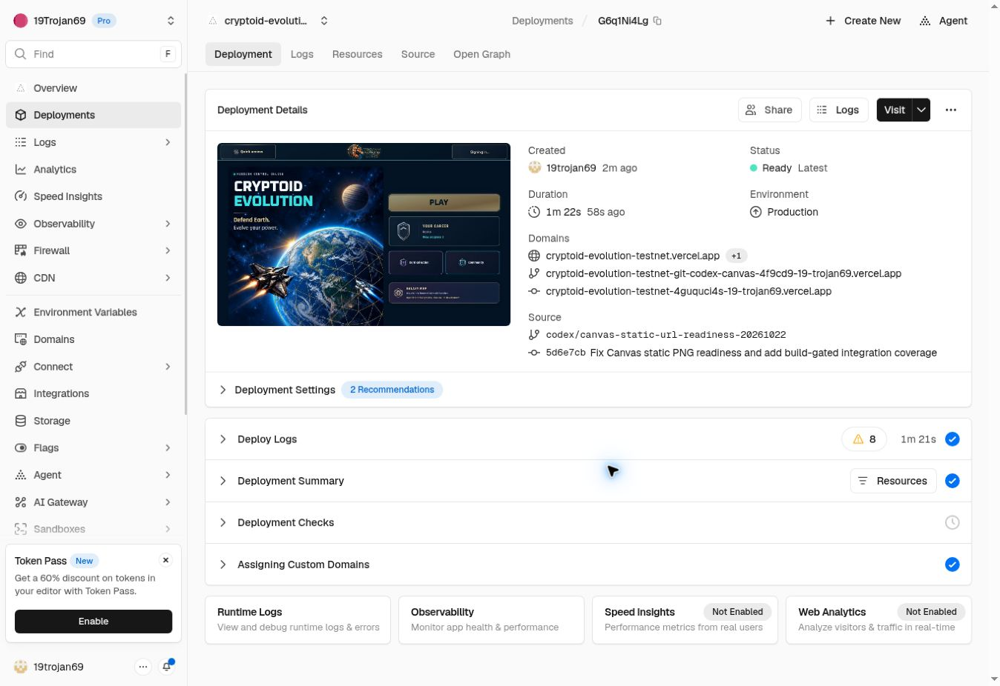

# Canvas static-URL Testnet release — 22 October 2026

The confirmed readiness defect is now corrected in the official Testnet at
https://cryptoid-evolution-testnet.vercel.app/ . The owner's latest “fortsetzen”
accepted the explicit request to publish the verified correction to Testnet.
This release does not prove that all iPhone White Screen causes are eliminated.

## Fixed source and rollback

| Item | Verified value |
| --- | --- |
| Runtime source | `5d6e7cb703ef114ee4626c1fbb0e34a45b1667d8` |
| Full source tree | `7d0fa724da3840b378d8de1e5723b24bfce19a89` |
| Fixed source branch | `codex/canvas-static-url-readiness-20261022` |
| Equivalent local candidate | `b1334d3eca87f940c31fb2f35051adeb8e9dd728` |
| Preview READY | `dpl_HvG3kARjrKwSLS54JS1hNR42iWN2` |
| Production READY | `dpl_G6q1Ni4Lgc3XZfvRbDTB7mk4rw5k` |
| Preview completion | 22 October 2026, 15:34:02 Europe/Vienna; 87 seconds |
| Production completion | 22 October 2026, 15:40:08 Europe/Vienna; 82 seconds total, 81-second Deploy Logs |
| Rollback branch | `backup/testnet-before-canvas-static-url-20261022` |
| Rollback source | `0bb35e5aeac49557edb8fd7379422066971e47de` |
| Preserved preceding READY | `dpl_AxeBWSTp1tKTYWWUe2ALcqcA6ktv` |
| Receipt branch, no deployment | `codex/canvas-static-url-release-record-20261022` |

The new remote source tree was independently checked against the complete local
candidate tree before deployment. Automatic deployment is disabled on source and
receipt branches. The signed-in Vercel dashboard created the preview and promoted
its exact source to the official Testnet. The promotion rebuilt with Production
settings; preview and production are not claimed to be identical binaries.

The Vercel connector again returned exact-resource 404s. The already authorized
dashboard fallback was used. Prior runtime-log/protection denials were respected;
no runtime logs, drains, bypass, Mainnet, credentials or account-data mutations
were involved. Existing fixed runtime/rollback refs remain preserved.

## Change and verification

`CanvasImpact` now compares the exact requested `sourceUrl` retained in its ready
resource bundle. A browser reflects relative `Image.src` values as absolute URLs;
the preceding comparison silently left the original HTML/CSS effect mounted.
Existing scale/generation checks and drawing remain intact. This is the sole
application runtime change. See [local verification](canvas-static-url-readiness-20261022.md)
for the complete fifteen-case integration suite, 54 exact native RGBA comparisons,
1000 warm impacts, unchanged artwork and passing existing regression/build checks.

The normally served preview was checked as a guest, through visible controls:

- Home loaded with Play enabled and started `/game`.
- Pause opened; Resume showed the `3` countdown and returned to active play.
- A normal kill raised score from 25 to 50; three lives remained.
- The actual `normal-effects-surface` canvas changed from idle 1x1 to active
  280x200. Six static ship styles were present at the initial DOM check.
- A second Pause succeeded.

One read-only pixel probe could not call `getContext` through the browser's DOM
adapter (`TypeError: c.getContext is not a function`). This was an inspection
capability failure, not an application exception. No alternate execution path or
bypass was attempted. Browser surface activation and local native pixel equality
are distinct evidence; no browser pixel-output equality is claimed.

After promotion, the independent public probe passed and saved
[after.json](canvas-static-url-release-20261022/after.json):

- Fresh Home and six delivered JS modules returned 200.
- GamePage and Admin identify the exact new runtime source and source tree.
- The requested-key guard and two `sourceUrl` resource bundles are delivered;
  the broken reflected-source guard is absent.
- Static revision `91a72bc0c36be9407915` remains delivered. Six served 282x282 PNGs
  match the already proven local production bytes exactly. The complete 1740-file
  catalogue was verified locally; no complete remote catalogue comparison is claimed.
- API root, anonymous Admin denial (401) and all three public leaderboard response
  hashes equal the fresh [before.json](canvas-static-url-release-20261022/before.json).
  Only status/length/hashes were saved, not leaderboard contents.
- Four production-only QA exclusions and absence of the test host pass.

A deliberately reloaded official Home finished loading with Spielen enabled.
Its immediate post-reload observation occurred during loading; the subsequent
visible-control check confirmed the enabled state. No owner or Pi login was used.

## Follow-up and limits

Reload the Testnet once and resume the existing mission. No reset or replacement
full campaign is required for these checks. Physical iPhone/PiBrowser observation
is still needed to assess longer-term stability. Native WebContent/GPU memory,
heat, audible output, presented FPS and the OS termination cause are not measured
by this release check. The confirmed integration defect is fixed; it is not proof
that it was the only cause of prior interruptions.

The receipt and screenshot are retained separately from the fixed runtime branch.
Do not deploy this receipt branch or move a fixed source/rollback ref with it.

