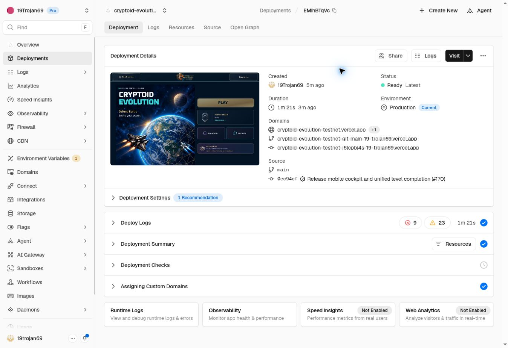

# Published mobile cockpit and unified level completion — 26 October 2026

PR #170 is merged. Both existing Vercel projects are READY on
`0ec94cf7ef6d5313013e75a774744e6f8b8d977b`, whose complete tree is identical to
reviewed `b7ed7c087ffd6ea20c4cc52def140e49ba17e05f` (tree `e45c79fdf9377ede13841aa46107d81644f1315a`).
No further game runtime change was needed after the handoff.

| Project | Deployment | Public domain | Network | Build |
|---|---|---|---|---|
| Testnet | `dpl_EMihBTqVcNgVNakk7iEr9i1ZBxNb` | https://cryptoid-evolution-testnet.vercel.app/ | testnet | 81 s |
| Production | `dpl_72rJpLoFoh6cb9qFNzWCw1AVsUzN` | https://cryptoid-evolution.vercel.app/ | mainnet | 73 s |

The authenticated Dashboard verifies both Production targets, current public
domains and exact source commits. Both releases ran through the normal Git
integration after the reviewed merge. No manual preview was published. The Vercel
connector's exact-project detail reads returned 404; the already authorized
Dashboard supplied the missing deployment evidence. No protection or credential
configuration was changed.

Fresh public HTTP checks pass on both domains: identical HTML and all seven
application bundles; exact release identity; unified completion, level-end marker,
next-checkpoint and reward confirmation; retained bounded invalid_save retry;
no local test hooks; API health 200; anonymous Admin 401; old diagnostic URL
redirects Home. Leaderboards report testnet and mainnet separately. The Testnet
API remains the established production proxy with its existing network routing;
production remains the local backend. No account, payment, database or environment
configuration was modified. No authenticated live player start or reward write
was performed. This does not verify real Pi payment/login behavior.

The canonical checkout again passed all 251 frontend release cases, TypeScript,
normal prebuild hull generation and Vite; all 126 backend tests and TypeScript;
and changed leaf-component ESLint. The inherited 39 WPE checks were inspected,
not counted as a newly repeated suite. GamePage still has its established 62
ESLint errors and four warnings, without additional runtime changes.

The additional `verify-completion-flow.mjs` executes actual GamePage/loop and API
handlers using an isolated in-memory account in native WPE/WebKit 26.5. Its 34
checks pass: boss defeat and the original in-game heart pickup precede bonus with no
statistics stop; perfect bonus shows an actually earned heart; a restored legacy
marker moves to the end and a zero-hit bonus shows no heart; final stage 500
retains its bonus checkpoint during forced save failure, keeps Continue locked,
retains the durable outbox, and succeeds on Retry. The next checkpoint and all
score/Shards/hearts match; ten prepared seconds and explicit Continue remain;
Continue adds no reward; final Continue reaches victory with a null mission.
Combat finishes through local-only hooks and the browser clock is controlled.
These are not physical iPhone/Pi Browser, full campaign, or native-memory tests.
The first overbroad verifier assertion compared the whole versioned checkpoint
rather than reward balances; its failure and host correction are preserved.
The early public fetch began during deployment and observed old Testnet/new
production; the final post-READY fetch passes for both. No runtime was changed
to accommodate either verification-host issue.

Rollback is independently preserved on GitHub at
`backup/shared-before-mobile-cockpit-20261026` -> `d0a0b81e175bbf955dfe06d9e693b08566aabfbb`.
Previous READY Testnet `dpl_65SLqpFEVhBWaSaArrmNgBM5vb8A` and production
`dpl_94e3az5zdn1969RBi71bxf9jAEmK` are the immediate rollback deployments.
The original workbranch remains fixed at b7ed7c0 with automatic deployment off.
This receipt is saved separately on an auto-deploy-disabled record branch and
must not replace either released runtime reference.

The historical White Screen remains unresolved. Preserve real background/focus
pauses and the strict >2500 ms watchdog with 500 ms polling, explicit Resume,
HUD, original art/audio, combat, economy and bounded save recovery. PR #167 and
PR #168 were not included. No new owner manual test campaign is requested.
Runtime logs were not scanned; no claim of zero live errors is made.

See `release.json`, `verification/mobile-cockpit/public-release.json`, and
`verification/mobile-cockpit/results/completion-flow/result.json` for evidence.

