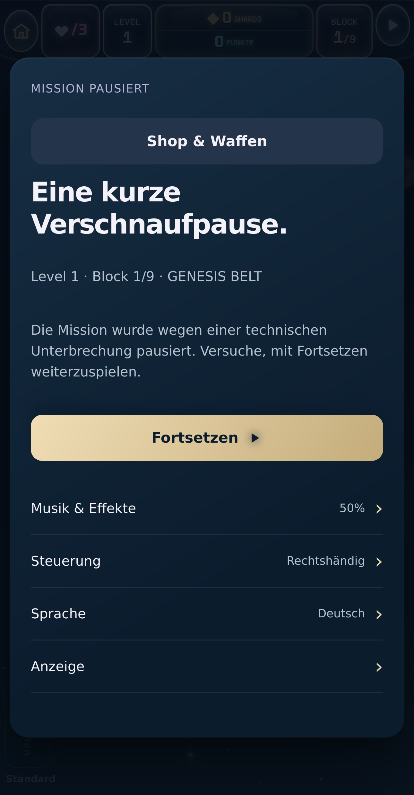

# WebKit-Kaltstart: technischer Pausegrund jetzt erfasst

Stand 24. Oktober 2026: Lokale Browserumgebung hergestellt, Produktionsbuild
und echte Browserpruefungen ausgefuehrt. **Der erste unveraenderte WebKit-
Bedienlauf scheitert mit einem aufgezeichneten `loop-stall`. Keine neue
Anwendungskorrektur, keine Gesamtfreigabe und keine Veroeffentlichung.**

## Gepruefter Ausgangsstand

- Bestehender Zweig: `codex/white-screen-startup-recovery-20261023`.
- Vollstaendiger Checkout und erneut gelesener Remote-Head:
  `33b137256eae06407985244499cc61cd0f3ef119`.
- Anwendung weiterhin Runtime `d84a4447e3318f06d4f28ccf7178adee28224295`.
- `frontend/src`: Git-Tree `66f458f157bb4d52b6ebe57f92d51b52a51451b2`.
- `frontend/index.html`: Git-Blob `e8bc2150e82e0ecb3745f78b8c33d5855851bec8`.
- `vercel.json`: Git-Blob `0a79c1585e3a4a3babf9ba28ff4413f10e715868`;
  automatisches Deployment fuer diesen Zweig bleibt `false`.

`frontend/AGENTS.md`, die beiden
`webkit-lifecycle-evidence-20261024`-Nachweise und die referenzierten Startup-,
Idle-Display-/Watchdog-, IDB-Callback-, Renderer- und Static-Hull-Nachweise wurden
vor der Untersuchung gelesen. Die aeltere Diagnose-Luecke bleibt historisch
korrekt dokumentiert. Ihr fehlender Pausegrund wird nicht nachtraeglich mit dem
Ergebnis dieses neuen Laufs aufgefuellt.

## Lokale Testumgebung

Beide Browser starten und erreichen dieselbe Art lokalen HTTP-Testservers auf
`127.0.0.1`: HTTP 200 und der tatsaechlich gelesene Text `local-server-ok`.
Die fruehere Sperre `ERR_BLOCKED_BY_ADMINISTRATOR` tritt hier nicht auf.
Preflight-JSON und native Bilder sind im Evidenzordner erhalten.

- Ubuntu 24.04; Node 24.19.0, npm 11.9.0.
- Chromium 141.0.7390.37 mit getrennt installiertem Playwright 1.56.0,
  entsprechend dem bereits dokumentierten kompatiblen Testhost.
- WPE-WebKit 26.5 aus dem regulaeren Playwright-Build `webkit-2336`, mit dem
  vorhandenen Playwright-Paket des Runtimes.
- 13 Originalschriftdateien fuer DM Mono, Oxanium, Rajdhani und Space Grotesk,
  insgesamt 1.573.700 Bytes. Alle 13 Groessen und SHA-256-Werte stimmen mit
  `idle-display-resume-guard-20261023/production-route-webkit.json` ueberein.
- Frontend-Abhaengigkeiten ueber `npm install --no-package-lock --no-audit
  --no-fund`, denselben NPM-Aufloesungsweg wie die Projektkonfiguration, ohne
  Manifest-/Lockdatei-Aenderung. Die wirklich aufgeloesten Versionen sind als
  `frontend-installed-dependencies.json` erhalten; insbesondere React/ReactDOM
  19.3.1, Vite 7.3.7, TypeScript 5.9.3 und Canvas 0.1.100. Dies wird nicht als
  Wiederverwendung eines identischen historischen Dependency-Baums ausgegeben.

Der zuerst angebotene Chromium-151-Download liefert eine 195-Byte-HTML-Seite
`Site Unavailable` statt ZIP. Fuer die bekannten kompatiblen Browser verwendet
der regulaere Installer seine eingebauten Downloadquellen; keine Downloadhost-
Umschreibung oder geaenderte Browser-Netzwerkregel. Der normale Systembibliotheks-
Installer scheitert am nicht erlaubten UID-/Gruppenwechsel des Paketmanagers.
Statt privilegierter Installation werden benoetigte Ubuntu-Bibliotheken lokal
entpackt. Die signierte `InRelease`-Datei wird mit dem vorhandenen Ubuntu-
Archivschluessel validiert, danach die Paketindizes und jedes Paket per SHA-256.
Paketversionen/Hashes und der ausgefuehrte Vorbereitungscode sind erhalten.
Kein APT-, Browser- oder Betriebssystem-Sandboxschalter wird zur Umgehung dieses
Fehlers hinzugefuegt; keine Hostpruefung wird ueber eine Skip-Variable abgeschaltet.

Die WPE-Ausfuehrung verwendet den dokumentierten eigenen `MiniBrowser`, seine
Bibliothekspfade, lokal entpackte GStreamer-Plugins und Linux-Softwaredarstellung
mit zwei Renderthreads. Das ist keine Aussage zur Hardwaredarstellung oder zur
hoerbaren Audioausgabe eines iPhones.

## Produktionsbuild und Startpruefungen

Der originale Build laeuft vollstaendig in einen frischen lokalen Ausgabepfad:

```sh
VITE_CRYPTOID_DIAGNOSTICS=0 npm run build -- --outDir <frischer-Ausgabepfad> --emptyOutDir
```

**151 Tests bestehen, null Fehler, null Skips**, dazu Sprach-Freigabepruefung,
Projekt-TypeScript und Vite. Die 1.740 Rumpfbilder bleiben bei Originalaufloesung,
95.450.326 Bytes und Revision `91a72bc0c36be9407915`. Die bekannte Vite-Warnung zum
grossen Bundle und die NPM-Proxykonfigurationswarnung bleiben sichtbar. Das Bundle
weist den Ausgangscommit mit `workingTreeDirty: true` aus; es wird kein sauberer
Release-Build behauptet. Die Anwendungsdateien stimmen per Git-/SHA-256-Pruefung
mit dem Ausgangsstand ueberein.

Der vorhandene, unveraenderte `verifyStartupRecovery.mjs` laeuft mit
`CRYPTOID_STARTUP_ROUTE_FLOW=1` zuerst in Chromium, danach einzeln in WPE-WebKit.
Die Diagnoseerfassung ist der echte Collector aus dem bestehenden Branch.

| Pruefung | Chromium | WPE-WebKit |
| --- | --- | --- |
| Browserstart und lokaler HTTP-Zugriff | Bestanden | Bestanden |
| Sieben Start-/Wiederanlauffaelle | 7/7 bestanden | 7/7 bestanden, separater Startlauf |
| Unveraenderter Bedienlauf Home/Play/Pause/Resume/Home | Bestanden | **Nicht bestanden**, nach Home/Play technische Pause |
| Zusaetzlicher Bedienlauf mit nativer Zeitmessung | Nicht erneut ausgefuehrt | Bestanden; separate instrumentierte Beobachtung |
| Vollstaendige Kampagne / iPhone-Langlauf | Nicht geprueft | Nicht geprueft |

Die sieben WPE-Startfaelle werden nach dem fehlgeschlagenen Bedienlauf separat
mit `CRYPTOID_STARTUP_ROUTE_FLOW=0` am selben Produktionsbuild abgeschlossen.
Sie ueberspringen lediglich den zusaetzlichen Spiel-Bedienlauf. Dadurch wird
dessen Fehler weder fortgesetzt noch zum Erfolg umgedeutet. Startfehler bleiben
bewusst erzeugte Transportfaelle; echte Anmeldung, Zahlungen und Spielstaende
werden nicht als getestet behauptet. ESLint der vier bestehenden Startup-
Pruefdateien und `git diff --check` bestehen.

## Tatsaechlich gesicherte technische Pause

Der erste originale WPE-Bedienlauf erreicht die echte Startseite und `/game`.
Der Collector sieht vor dem angeforderten Pause-Klick ein sichtbares, fokussiertes
Dokument mit `effectsPaused="false"`, ohne Pause-Overlay oder Diagnoseeintrag.
Beim Klickversuch legt sich das technische Pause-Overlay ueber den Knopf.
Der unveraenderte Test scheitert nach 20 Sekunden und erfasst vor dem Schliessen:

- `failure.stage`: `pause-click`, `failure.name`: `TimeoutError`.
- `diagnostics.state`: `read`; genau ein aktueller Unterbrechungseintrag.
- `reason`: **`loop-stall`**, `phase`: **`SECTOR_INTRO`**,
  `encounter`: `normal`, `status`: `paused`, Sektor 1, Block 1.
- Zeitpunkt: `2026-10-24T05:38:35.992Z`; der Eintrag liegt im beobachteten Ablauf
  und nach dem unveraenderten Dokumentbeginn.
- Null Gegner, Projektile und Effekte im aufgezeichneten Kontext.
- Das sichtbare Dialogfeld meldet die technische Unterbrechung. Es belegt
  allein keinen Grund; diesen liefert der aktuelle Diagnoseeintrag.
- Das am Mittelpunkt des Pauseknopfs getroffene Element ist das Overlay,
  `insidePauseControl: false`; die Oberflaeche ist weiterhin vorhanden.
- Keine ungefangene JS-Exception, Konsolen-/HTTP-/Anforderungsfehler,
  unerwartete externe Anfrage oder fehlende lokale Datei in diesem Lauf.
- `failureScreenshot.captured`: `true`; originales Bild unten.



Das Dokument wird nicht ersetzt. Dieser Befund ist ein aufgezeichneter lokaler
Stillstandsschutz mit sichtbarer Pause, kein reproduzierter White Screen und
kein nativer Prozess-Speicherabbruch. Der genaue Abstand der ausbleibenden
Callbacks und die blockierende Quellfunktion wurden vom unveraenderten
Diagnoseformat nicht gemessen. Aus `loop-stall` folgt noch keine bestimmte
Allokation, Renderingebene, Audiofunktion oder Ursache auf dem iPhone.

## Begrenzte Folgeuntersuchung und Entscheidung

Eine lokale Kopie des Pruefhosts ergaenzt ausschliesslich den schon vorhandenen
nativen Timeline-/ScriptProfiler-/CPUProfiler-Collector und einen Zeitstempel.
Die Anwendung, ihr Produktionsbundle und saemtliche Interaktionen bleiben
unveraendert. In diesem zweiten WPE-Bedienlauf tritt die technische Pause nicht
auf: Home/Play/Pause/Resume/Home passiert, und kein aktueller Diagnoseeintrag
wird erfasst. Die native Aufnahme enthaelt 3.173 Timeline-Records,
1.184 Script-Records und 21 CPU-Records ohne Overflow oder nicht unterstuetzte
Kommandos. Rohdaten und die genau ausgefuehrte Hostkopie sind erhalten.

**Diese Aufnahme erfasst nicht den fehlgeschlagenen Lauf.** Instrumentierung,
vorherige Hostaktivitaet und Cachezustaende koennen die Ausfuehrung beeinflussen.
Sie wird deshalb weder als Ursache des ersten Stalls noch als korrigierte
WebKit-Abnahme ausgegeben. Die frueher verworfenen Renderer-/Cache-/Zuschnitt-
Experimente wurden nicht wieder aufgenommen. Es gibt keinen belegten sicheren
Quellcodeeingriff, der aus diesen beiden Beobachtungen folgt.

Nach der erneuten Fortsetzungsanweisung beobachtet eine weitere lokale Hostkopie
nur die originalen Browser-RAF-Aufrufe und den bestehenden 500-ms-Intervall.
Weiterleitende Browser-API-Wrapper protokollieren Aufruf-/Liefer-/Endzeiten in
einen auf 512 Eintraege begrenzten Arbeitsspeicher. Der originale Diagnose-
Schreibaufruf wird unveraendert weitergereicht; ein technischer Eintrag wuerde
die Beobachtung einfrieren. Keine zusaetzlichen Timer, RAF-Ketten, Speicher-
Schreibzugriffe oder Uhrveraenderungen. Das ist Testinstrumentierung, keine
Anwendungsintegration; auch diese Beobachtung kann die Ausfuehrung beeinflussen.

Dieser kurze Ablauf besteht ebenfalls ohne technischen Eintrag. Alle 359
Beobachtungen sind erhalten, null verworfen: 105 beendete RAF-Callbacks mit
hoechstens 4 ms, 17 beendete Intervall-Callbacks mit hoechstens 1 ms und maximal
1301 ms Abstand zwischen beobachteten nativen RAF-Lieferungen. Diese Werte
umfassen den kurzen Bedienablauf einschliesslich seiner gewollten Pause; sie
sind weder aktive Spiel-FPS noch eine Messung des urspruenglichen Stall-
Intervalls. Die Quelltexte, Rohdaten und berechneten Werte stehen separat unter
`callback-observation-*`. Auch dieser Erfolg ersetzt den ersten Fehllauf nicht.

Deshalb keine spekulative Runtime-Aenderung: `GAME_STALL_MS` bleibt 2500 und
beide Vergleiche bleiben strikt `>`; `GamePage` behaelt `setInterval(..., 500)`.
Es gibt kein automatisches Resume und keinen erzwungenen Klick. Nach der
unerwarteten Pause wird weder weitergespielt noch ein Fortsetzen ausgeloest.
Der erfolgreiche Folgeablauf benutzt ausschliesslich die angeforderte normale
Pause und ihren urspruenglichen Resume-Button.

## Gesicherter Umfang und offene Grenze

Diese Fortsetzung aendert nur Nachweise und den Hinweis in `frontend/AGENTS.md`.
`frontend/src`, `frontend/index.html`, Paketmanifest, Lockdatei, Grafiken, CSS,
HUD, Audio, Spielmechanik, Timing, Backend/API, Kauf- und Speicherlogik bleiben
identisch. Keine echten Konten, Kaeufe oder Spielstaende wurden verwendet oder
geaendert. Kein Merge, kein Deployment, kein Aliaswechsel, keine Bewegung fester
Release-/Rollbackreferenzen; Mainnet und Testnet bleiben unberuehrt.

Die Testumgebung und die neue tatsaechliche Pauseerfassung sind hergestellt.
Der vollstaendige Spielablauf ist weiterhin nicht freigegeben; die historischen
iPhone-White-Screens, ihre aktuelle konkrete Ursache und der iPhone-Langzeit-
Stabilitaetsnachweis bleiben offen. Es wird keine neue vollstaendige Kampagne,
kein erneuter Kauf, kein Browserdaten-Loeschen und kein neuer OS-Bericht vom
Eigentuemer verlangt. Fuer die weitere Eingrenzung ist eine Aufnahme des
tatsaechlich scheiternden Callback-Intervalls erforderlich, bevor eine
Anwendungskorrektur oder deren Erfolg behauptet werden kann.

Alle maschinenlesbaren Ergebnisse, Quellen- und Evidenzpruefsummen stehen in
`webkit-cold-start-investigation-20261024.json` und im gleichnamigen Ordner.

## Sicherung nach automatischer Ablehnung des GitHub-Pushs

Der erste lokale Evidenzcommit ist `7bc2361`. Die automatische Freigabe lehnt
seinen Push auf den bestehenden GitHub-Arbeitsbranch mit der Begruendung ab,
der Nutzer habe Veroeffentlichung untersagt und ein Remote-Upload dieser
Diagnose-/Umgebungsdateien sei nicht autorisiert. Es erfolgt kein erneuter
Schreibversuch ueber einen anderen Zugang. Die anschliessende Nur-Lese-Pruefung
bestaetigt den Remote-Head weiterhin bei `33b137256eae06407985244499cc61cd0f3ef119`.

Die neuen Commits und Ergebnisse bleiben lokal gesichert. Ein eigenes privates
Diagnosepaket enthaelt die Nachweise und einen binaerfaehigen Git-Patch der
ungesendeten Dokumentationscommits, damit sie nach dem bekannten Ausgangsstand
wiederherstellbar sind. Es enthaelt keinen gesamten Repository-Klon und keine
Abhaengigkeiten, Zugangsdaten oder echten Benutzer-/Kauf-/Spielstanddaten.
