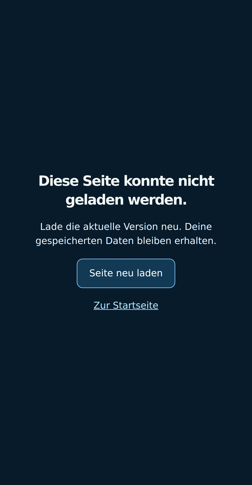
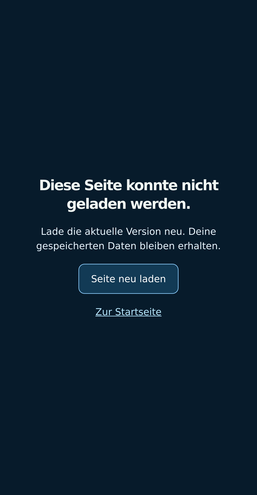

# White Screen: reproduzierte Startblockaden abgesichert

Die neue Korrektur gibt bei einem fehlgeschlagenen oder hängenden Seitenstart
eine bedienbare Fehleranzeige aus. Der dokumentierte iPhone-Speicherabbruch ist
damit **nicht** als behoben nachgewiesen. White Screens haben nach der erneuten
Anweisung des Eigentümers oberste Priorität.

- Runtime: `d84a4447e3318f06d4f28ccf7178adee28224295`
- Tree: `4acca9df81e7af3cf4a33685f563638a84fdce1f`
- Ausgangsstand: `acd96687eaa9ba1a6e6da39e49f9e644717af34f`
- Zweig: `codex/white-screen-startup-recovery-20261023`
- Status: geprüft und gesichert, nicht veröffentlicht; automatisches Deployment aus.

## Befund und Korrektur

Das unveränderte Pi-SDK wurde synchron im Kopf des Dokuments geladen. In beiden
nativen Testbrowsern verhindert eine absichtlich offen gehaltene SDK-Anfrage
sogar das Anlegen von `body` und `#root`. Es erscheint weder Inhalt noch eine
Fehleranzeige. Ein fehlendes Einstiegsskript oder ein ausbleibender erster
Routen-Chunk lässt ebenfalls eine leere Oberfläche zurück. Zehn Ausgangsproben
enthalten zwei erfolgreiche Normalstarts und acht solche Leerkontrollen.

Die identischen SDK-/`Pi.init`-Skripte stehen jetzt hinter dem bereits angelegten
Seitenkörper und `#root`. SDK-Adresse, Version `2.0`, synchrone Ausführung und
Reihenfolge vor dem App-Einstieg bleiben erhalten. Die Anwendung startet
weiterhin erst nach diesem ursprünglichen Initialisierungsablauf.

Eine kleine Inline-Absicherung wird vorher installiert und benötigt weder SDK,
App-Bundle, React, Routen-Chunk noch externe Schriftdateien. Ist nach acht Sekunden
noch kein erstes UI-Element in `#root` vorhanden, zeigt sie die bestehende
Fehlermeldung mit »Seite neu laden« und »Zur Startseite«. Ein Ladefehler des
Einstiegsmoduls kann die Anzeige früher auslösen. Die Anzeige verwendet dieselben
vorhandenen Übersetzungen und Englisch-Fallbacks wie die Anwendung.

Es gibt keine automatische Wiederholung oder Navigation. Ein später doch
erfolgreicher Start entfernt die Fehleranzeige. Sobald die erste Oberfläche
erscheint, werden Timer, Beobachter und Fehlerlistener vollständig abgebaut.
Das laufende Spiel wird danach nicht von dieser Startabsicherung überwacht.
Sie liest bei Bedarf ausschließlich die Spracheinstellung; Speicherdaten werden
weder geändert noch gelöscht. Die Startabsicherung fügt keine Netzwerkanfrage
und keine Animationsschleife hinzu.

## Prüfungen

| Kontrollierter Browserfall | Ergebnis in Chromium und WPE-WebKit |
| --- | --- |
| Normaler Start | Startseite erreichbar, keine zusätzliche Anzeige |
| Pi-SDK bleibt aus | Gerenderte Fehleranzeige; nach späterer SDK-Antwort normaler Start ohne Neuladen |
| Einstiegsskript liefert 404 | Fehleranzeige; manuelles Neuladen öffnet die Startseite |
| Einstiegsskript bleibt aus | Fehleranzeige; spätere Antwort öffnet die Startseite ohne Neuladen |
| Erster Startseiten-Chunk bleibt aus | Fehleranzeige; spätere Antwort öffnet die Startseite ohne Neuladen |
| Einstiegsskript wirft eine Exception | Fehleranzeige; manuelles Neuladen funktioniert |
| Einstiegsskript scheitert mit Offline-Fehler | Fehleranzeige; manuelles Neuladen funktioniert |

Alle **14 Start-/Wiederanlauffälle** bestehen bei 430×825 CSS-Pixeln und DPR 3.
Chromium ist Version 141.0.7390.37, Linux-WPE-WebKit Version 26.5 mit
Softwarerendering. Originalschriften werden lokal bereitgestellt; SDK, API und
Speicher-Testmarken sind synthetisch. Jede erfolgreiche Dokumentinstanz ruft die
ursprüngliche SDK-Initialisierung genau einmal mit Version `2.0` auf. Alle sechs
Fehlerfälle je Browser erreichen danach die echte Produktions-Startseite.
Die bewusst erzeugten 404-/Offline-/Exception-Fehler bleiben in den Berichten
sichtbar und werden nicht als fehlerfreie Ausgangsläufe ausgegeben.
Die Testmarken werden je Testdokument gesetzt; ihr Wert nach dem Neuladen beweist
keine echte Spielstand-Speicherung. Der separate Nur-Lese-Test der Absicherung
und die unveränderten Spielstandmodule begrenzen hier die geprüfte Aussage.

Beide folgenden Bilder zeigen tatsächlich aufgenommene Browserpixel bei weiterhin
blockierter SDK-Anfrage. Geometrie allein war kein ausreichender Anzeigenachweis.

Zwölf neue Node-Regressionen führen den tatsächlichen Inline-Code aus und prüfen
unter anderem die exakte 7999-/8000-ms-Grenze, Abbau aller Beobachtung nach dem
Start, fehlenden Speicherzugriff, ausschließlich manuelles Neuladen, spätes
Laden und alle 19 auswählbaren Sprachvarianten samt vorhandenen Fallbacks.
Die gepinnte Original-HTML-Datei hat Git-Blob
`c9f7cc2058c56c35f1a4d470f0451c8371c97b09`.

Der vollständige Build besteht **131 Tests**, Sprach-Freigabeprüfung, Projekt-
TypeScript und Vite. Der lokale Aufruf verwendet einen frischen Ausgabepfad:
`VITE_CRYPTOID_DIAGNOSTICS=0 npm run build -- --outDir <Ausgabepfad> --emptyOutDir`.
Die 1740 Rumpfbilder bleiben bei Originalauflösung, 95.450.326 Bytes und Revision
`91a72bc0c36be9407915`. Die vorhandene Vite-Warnung zum großen Bundle bleibt.
Beide neuen Prüfskripte bestehen ESLint; der komplette Änderungsumfang besteht
`git diff --check`.

Alle Dateien unter `frontend/src` sind gegenüber dem Ausgangsstand unverändert.
Das betrifft insbesondere Spielschleife, GamePage, Router, Pi-Anmeldung,
Zahlungslogik, Spielstände, Grafiken, CSS und Audio. Die einzigen neuen Runtime-
Änderungen liegen in `index.html`; hinzu kommen Tests, Testfixture, Build-Gate
und deaktiviertes Kandidaten-Deployment.

## Offene Befunde und verworfene Nachweise

Der zusätzliche Chromium-Bedienlauf Home → Play → Pause → Resume → Home besteht.
Ein zusätzlicher unmittelbar nach dem Start bedienter WebKit-Spieltest bricht
nach Home → Play ab: Eine Pause-Überlagerung verhindert den angeforderten Klick
auf Pause. Es gibt dabei keine ungefangene JS-Exception und keinen HTTP-Fehler.
Der genaue Auslöser dieser Pause wurde in diesem Lauf nicht erfasst. Der Lauf
ist **nicht bestanden** und bleibt separat erhalten. Die folgenden isolierten
Startfehlerfälle prüfen die Startabsicherung bis zur Startseite; sie ändern
diese Bewertung des zusätzlichen Spieltests nicht.

Eine erste Kopfbereich-Variante zeigte zwar DOM-Geometrie, erreichte jedoch
keine abgeschlossene Bildaufnahme bei blockiertem Parser und wurde verworfen.
Der erste Aufnahmetest wartete zusätzlich auf `document.fonts.ready`, das bei
absichtlich blockiertem Parser ebenfalls ausbleibt. Der finale Testhost nimmt
die sichtbare Systemschrift-Anzeige ohne diese optionale Schriftwartebedingung
auf. Das ist ausschließlich eine Einstellung des lokalen Aufnahmewerkzeugs.

Ein früher lokaler Standard-Ausgabeversuch enthält keine abschließende Vite-
Zusammenfassung; ein separater Versuch in dasselbe Ausgabeverzeichnis scheitert
mit `ENOTEMPTY`. Diese Versuche zählen nicht als fertiger Build. Der nach der
finalen SDK-Verlagerung vollständig neu ausgeführte Build im frischen
Ausgabeverzeichnis besteht alle Schritte einschließlich Vite-Abschluss.

Der bereits dokumentierte Jetsam-Befund vom 21. Oktober betrifft eine aktive
WebContent-Beendigung an einer Prozess-Speichergrenze von etwa 2,02 GiB beim
älteren Runtime-Stand `f85360ed`. Er identifiziert keine einzelne verursachende
Spielressource und ist kein zu späteren Unterbrechungen passend nachgewiesenes
OS-Ereignis. Siehe `static-hull-memory-20261022.md`. Dieser Schritt enthält
keine neue iPhone-Speichermessung und keinen Nachweis gegen eine native
Prozessbeendigung. Eine Startanzeige kann einen bereits beendeten Prozess nicht
am Leben halten oder ungespeicherte Fortschritte rekonstruieren.

Die historischen Geräte-White-Screens und die früheren aktiven Loop-Stalls
bleiben offen. Keine Grafikreduktion, kein Abschalten des Stall-Schutzes, kein
automatisches Resume und keine erneute lange Eigentümer-Kampagne, kein Kauf,
Speicherlöschen oder OS-Bericht werden für diese Prüfung verlangt. Die alten
verworfenen Renderer-/Cache-/Zuschnitt-Experimente sind nicht übernommen.

## Reproduktion und Freigabegrenze

`npm run test:startup-recovery` ist Teil von `npm run build`.
`scripts/verifyStartupRecovery.mjs` prüft das gebaute HTML und die echte
Produktions-Startseite mit kontrollierten Transportfehlern.

- `CRYPTOID_STARTUP_DIST`: optionaler Pfad zum Produktionsbuild, Standard `dist`.
- `CRYPTOID_STARTUP_FIXTURE_ROOT`: Verzeichnis mit ursprünglicher
  `route-fonts.css`, `route-font-manifest.json` und den referenzierten Schriftdateien.
- `CRYPTOID_STARTUP_ENGINE`: `chromium` oder `webkit`.
- `CRYPTOID_PLAYWRIGHT_PACKAGE`: optionaler installierter Playwright-Paketpfad.
- `CRYPTOID_BROWSER_EXECUTABLE`: optionaler installierter Browserpfad; dessen
  Bibliothekspfade/Umgebung müssen vorhanden sein.
- `CRYPTOID_STARTUP_REPORT`: JSON-Ausgabe.
- `CRYPTOID_STARTUP_ROUTE_FLOW=1`: zusätzlicher separater Spiel-Bedienlauf;
  dessen aktueller fehlgeschlagener WebKit-Kaltstart bleibt dokumentiert.

Die gleichnamige JSON-Datei und der Evidenzordner enthalten Prüfergebnisse,
Prüfsummen, die Ausgangskontrollen, Bilder und den fehlgeschlagenen Spieltest.
Die Berichte behalten die Build-Herkunft `acd9668` plus damaligen uncommitteten
Kandidaten; ihre HTML-SHA-256 stimmt exakt mit Runtime `d84a444` überein.
Kein Deployment, kein Hauptzweig-Merge und keine Änderung an festen Release-/
Rollbackreferenzen oder Mainnet wurden vorgenommen.
