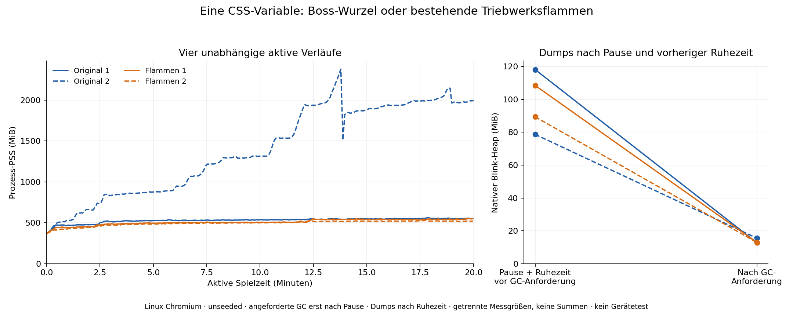

# Isolierter Vererbungsbereich der Boss-Schubvariable – 2. November 2026

Direkte Fortsetzung von `8f2d7080`: Die native Langmessung zeigt große
bereinigbare Blink-/Style-Bestände. Die anschließend tatsächlich beobachtete
CSS-API-Zählung findet 1.797 Schreibzugriffe der Boss-Schubvariable in einer
aktiven Minute, davon 1.796 mit geändertem vorherigem Aufrufwert. Die Variable
wird am großen Boss-Wurzelknoten gesetzt; die unveränderte Quelle verwendet
sie nur für die Höhe der bestehenden Triebwerksflammen.

## Genau eine virtuelle Änderung

`control` baut das Originalmodul `BossHullView.tsx` bytegleich. `leaf` berechnet
denselben Ausdruck weiterhin einmal und deklariert denselben String direkt
an den vorhandenen Flammen statt an der Wurzel. Nur drei exakte Textstellen
ändern sich; die vollständige Umkehrung muss das Original-Blob
`68dd74e598caa060ae8825d3c56b199ba0d08449` ergeben. Kein anderer Style, Knoten,
Anker, Sprite, Effekt, Canvas, natives Easing, Ton, Spielobjekt, Spieluhr oder
Cleanup-Pfad ändert sich. Es gibt keine neue App-Schleife, RAF, Timer oder
Beobachter. Dateien unter `frontend` bleiben unverändert; das Renderingmodul
wird ausschließlich im ausdrücklich bezeichneten QA-Build transformiert.

Dies ist eine Hypothesenprüfung, noch kein übernommener Spiel-Patch. Bei mehreren
Flammen entstehen zusätzliche Style-Schreibzugriffe; deren Anzahl ist kein
Erfolgskriterium. Der vermutete Nutzen liegt in geringerer Vererbung an
nicht verbrauchende Unterbäume. Speicherwirkung muss tatsächlich gemessen werden.
Die früheren Mini-Start-Guards und alle Flat-/Filter-/Canvas-/Masken-Kontrollen
bleiben aus. Neue Style-API-Beobachtungswrapper dürfen nicht kombiniert werden.

## Technische Gates

Fünf neue Regressionen führen den ursprünglichen und den transformierten JSX-
Funktionskörper aus. In 600 Kombinationen aller 50 tatsächlichen Boss-Geometrien
mit Bewegungs-/Eintritts-/Gesundheitszuständen sind alle anderen Knoten und Props
gleich; jede bestehende Flamme erhält exakt den ursprünglichen String. Alle
50 fallenden Bossdarstellungen und fehlende Modelle bleiben vollständig gleich.
Beide virtuellen vollständigen TypeScript-Varianten müssen bestehen.

Danach beginnen zwei frische kurze Browserläufe, je 60 aktive Sekunden. Erst
nach bestätigter bestehender Home-Dialogpause wird die aktuelle Deklaration
einmal auf die Gegenseite verteilt und zurückgesetzt. Derselbe gerade gerenderte
Wert wird verwendet. Der echte Browser muss exakt gleiche berechnete Flammen-
höhen und Variablenwerte sowie dieselben nativen Animationsobjekte, Startzeiten
und Wiedergaberaten liefern. Die ursprünglichen Inline-Styles werden vollständig
wiederhergestellt. Das SVG erbt die Variable nur im Kontrollzustand. Kein App-
oder Animationsclock-Schreibzugriff ist Bestandteil dieses Nachweises.

Diese inaktive Prüfmutation erfolgt ausschließlich im Kurzlauf, vor der
folgenden Heap-Erfassung. Sie ist kein unbeeinflusster Speicher-Kontrollwert.
Erst wenn beide Varianten bestehen, beginnen vier unabhängige Langläufe mit
je 20 Minuten tatsächlich beobachteter aktiver Zeit: zweimal Original, zweimal
Flammendeklaration. Keine aktiven API-Wrapper, Traces, Snapshots, GC, Screenshots,
Animationsscans oder Verteilungsmutationen. Quellen, Engine, Pakete, Lock-Digest,
aktive Uhr, fortlaufende Frames und Kernsalven werden geprüft.

Nach der aktiven Strecke verwendet jeder Lauf dieselben bestehenden zehn
Freigabegrenzen, zwei Heap-Snapshots und vier expliziten nativen Allokator-Dumps
erst nach der bestätigten Pause. Die Zuordnung, Fragment-/Aliasgrenzen und
Diagnoseeinflüsse aus der vorigen Phase bleiben Grundlage der Auswertung.
Vier unseeded Läufe ersetzen keine physische Geräteabnahme. Ein niedriger
einzelner Endpunkt gilt nicht als bestätigte Verbesserung.

Es wird keine neue Spiel-/Geräteversion veröffentlicht. Die offene WebKit-
Original-Startlücke, die Mini-Start-Negativserie und der ungeklärte Smartphone-
White-Screen bleiben erhalten. Die folgenden Abschnitte dokumentieren den
tatsächlich abgeschlossenen Vergleich.

## Abgeschlossener wiederholter Chromium-Vergleich

Quelle `600892649a97b4ade8530ca84a507fded5872d0e`, Baum
`fa80782bee79c11359713424de689d9a8766ce0f`,
[CI 41384115772](https://github.com/19Trojan69/cryptoid-evolution/actions/runs/41384115772).
Alle sieben Jobs sind erfolgreich: Quellen-Gates, beide kurzen nativen
Darstellungsprüfungen und alle vier 20-Minuten-Aufnahmen. Jede Langaufnahme
beobachtet mindestens 1.200.000 ms aktive Zeit und 428 zusätzliche Kernsalven.
Alle sechs Captures verwenden dieselbe tatsächliche Chromium-Version
151.0.7922.34, dieselben erfassten fünf Top-Level-Pakete und denselben Lock-Digest.
Die zufällige Renderarbeit ist dadurch nicht vollständig gematcht.

Die beiden kurzen Browserprüfungen bestätigen je zwei vorhandene Flammen,
identische berechnete Variablenwerte/Höhen vor/nach Umverteilung, dieselben
Animationsinstanzen/Startzeiten/Raten und die vollständige Style-Wiederherstellung.
Die Werte der **beiden unabhängigen** Kurzläufe sind nicht untereinander identisch:
Die Flammen befinden sich in verschiedenen zufälligen Momentzuständen. Der
Gleichheitsnachweis vergleicht jeweils denselben Zustand vor/nach der gezielten
inaktiven Umverteilung. Alle ursprünglichen Engine-Positionen/Anker bleiben erhalten.

| Lauf | PSS erste aktive Minute | letzte aktive Minute | Änderung | Stichproben-Spitze | Mittel der abgedeckten Stichproben |
| --- | ---: | ---: | ---: | ---: | ---: |
| Original 1 | 471,2 MiB | 552,6 MiB | +81,4 MiB | 562,0 MiB | 529,9 MiB |
| Original 2 | 492,9 MiB | 1.977,9 MiB | +1.485,0 MiB | 2.378,4 MiB | 1.398,5 MiB |
| Flammen 1 | 440,1 MiB | 545,4 MiB | +105,3 MiB | 551,9 MiB | 509,7 MiB |
| Flammen 2 | 413,7 MiB | 520,2 MiB | +106,5 MiB | 530,6 MiB | 496,0 MiB |

Erste/letzte Minute sind Mediane. Das Mittel ist trapezförmig über die tatsächlich
abgedeckten PSS-Stichproben berechnet; die kurze unbeobachtete Endstrecke wird
getrennt gespeichert. Es ist kein exaktes Integral aller nativen Allokationen.

**Beobachtet:** Beide Vergleichsläufe liegen bei absoluten End-, Mittel- und
Stichproben-Spitzenwerten unter beiden Kontrollen. Allerdings unterscheiden sich
bereits die ersten Minuten; die Zunahme gegenüber diesen Werten ist bei beiden
Vergleichsläufen größer als bei Original 1. Die Kurven dieses Originals und der
Vergleichsbedingung liegen nahe beieinander, während Original 2 stark abweicht.
Verschiedene Startwerte können selbst teilweise von der Bedingung beeinflusst
sein; sie werden weder als sicher unabhängiger Offset noch als gesicherter
Behandlungseffekt bezeichnet. Zwei unseeded Wiederholungen trennen diese Effekte
und natürliche Bereinigungszeitpunkte nicht zuverlässig.

Das ist ein positiver Hinweis bei absoluten Prozesswerten, **keine bestätigte
dauerhafte Speicherkorrektur**. Der Vergleich wird nicht als Runtime-Fix übernommen.
Die schon früher beobachteten guten und schlechten Läufe gleicher Quelle bleiben
relevant; ein bestandener Einzel-Langlauf definiert weiterhin keine stabile Version.

## Bereinigungszeitpunkte und Grenzen der nativen Zuordnung

| Lauf | PSS Pause sofort nach Diagnosebeginn | Pause nach fünf Sekunden, vor GC-Anforderung | Pause nach GC-Anforderung | Blink-Heap vor / nach Anforderung |
| --- | ---: | ---: | ---: | ---: |
| Original 1 | 560,2 MiB | 554,1 MiB | 435,3 MiB | 118,1 / 12,8 MiB |
| Original 2 | 1.996,2 MiB | 522,9 MiB | 450,7 MiB | 78,7 / 15,5 MiB |
| Flammen 1 | 553,3 MiB | 547,9 MiB | 433,2 MiB | 108,4 / 12,9 MiB |
| Flammen 2 | 527,0 MiB | 522,3 MiB | 430,5 MiB | 89,3 / 13,0 MiB |

Der große Rückgang von Original 2 liegt **vor unserer GC-Anforderung**. Pause,
normale Browserbereinigung, vorherige Profiler-/Zählerzugriffe und die Ruhezeit
lassen sich aus dieser Aufnahme nicht einzeln als Ursache trennen. Der erste
native Allokator-Dump startet erst nach dieser Ruhephase und erfasst deshalb
die vorherige aktive 2,3-GiB-Spitze nicht. Ein niedrigerer Pausen-Dump ist kein
Beweis eines niedrigeren aktiven Peaks. Die Dumps und die Tracing-Anhängung
beeinflussen darüber hinaus selbst den Prozessspeicher; Vor-/Nachwerte bleiben
für alle sechs Captures gesichert. Native Kategorien, Eltern/Kind-Zeilen und
Prozessfragmente werden weiterhin nicht addiert.

Nach angeforderter GC liegen die vier pausierten JS-Heaps bei rund 10,6–10,7 MB.
Nach Home sind wieder 247 DOM-Knoten/210 JS-Listener gemessen, null aktive
CSS-Registrierungen/Bild-Pins/Effektcache/Spiel-Canvas. Die Canvas-Kategorie beträgt
vor/nach GC jeweils 1.880.312 Byte und nach Home jeweils 1.032.192 Byte für den
bereits bekannten begrenzten Steintexturcache. Gelesene CSS-Fallbacks, Canvas-Fehler
und Audio-Uhrstillstände bleiben null. Es gibt keinen neuen belegten dauerhaften
Spielbesitz-Leak in diesen Freigabegrenzen.

## Eigenständiger WebKit-Befund

Quelle `7254b8acb121497c6fcf708f19dbcbae95edd177`, Baum
`8cd5cac70de6e375a881d93ea086747c2d9dd26f`,
[CI 41385089320](https://github.com/19Trojan69/cryptoid-evolution/actions/runs/41385089320)
ist **fehlgeschlagen**. Vier frische Linux-WebKit-26.5-Abläufe, je zwei pro
Bedingung, scheitern am unverändert strikten Gate für eine unbeobachtete
Stoppuhrlücke. Original 1 und beide Vergleichsläufe scheitern vor dem ersten
akzeptierten Messintervall. Original 2 besteht eine gemessene Minute
(60.736 ms), den ganzen UI-Ausstieg und einen zweiten kurzen Durchlauf
(10.763 ms), scheitert dann am dritten Einstieg. Die beiden abgeschlossenen
Teilstrecken bestehen auch in WebKit die native Umverteilungs-/Höhen-/Animations-
prüfung. Der vollständige Ablauf bleibt trotzdem fehlgeschlagen.

Die letzten Zustände sind sichtbar, spielen und melden keine technische Pause;
die Stoppuhr hat jeweils eine unbeobachtete Lücke. Das beweist hier keinen
nativen Prozessabbruch, White Screen oder tatsächlichen Spiel-Freeze. Ebenso
belegt es keine kausale Verschlechterung durch die neue Variablenverteilung.
Der frühere WebKit-Startbefund ist damit erneut relevant. Es gibt keine
automatische Wiederaufnahme, keine nachträglich gelockerten Gates und keine
physische iPhone-/Pi-Browser-Abnahme. WebKit-Daten werden nicht in den mit
identischer Quelle erhobenen Chromium-Speichervergleich eingerechnet.

## Gesicherter Stand und nächste Eingrenzung

Alle zehn ZIP-Digests/Integritäten, 24 native Dumps und zwölf Heap-Graphanalysen
sind geprüft. Sechs Chromium-Captures mit ihren vollständigen gefilterten nativen
Traces und vier fehlgeschlagene WebKit-Captures sind verlustfrei unter `evidence/`
gesichert. Die Roh-Heapgraphen und Roh-Besitzerberichte werden nicht in Git
übernommen. Der Default-Build ohne Vergleichsflag wurde separat gebaut: originale
Szene, vorhandene Inspektionsbrücke, keine neue Thrust-Transformation oder
Mini-Start-Behandlung; unveränderte Spielquellen-Pins bestehen danach.

Die neue aktive Spitze, die vor dem ersten Pausen-Dump bereits verschwunden ist,
priorisiert zuerst eine **einzelne leichte native Aufnahme während eines
tatsächlich beobachteten hohen Prozess-PSS**. Sie muss als eigener instrumentierter
Diagnoseaufbau gekennzeichnet bleiben; die bisherigen unbeeinflussten aktiven
Langmessungen werden dadurch nicht ersetzt. Die ursprünglichen inaktiven Gates
dürfen dafür nicht gelockert werden. Ein eigener aktiver Schwellenwert-Collector
muss Quelle, Spielzustand und Druckmessung prüfen, ohne eine automatische
Wiederaufnahme oder eine GC zu erzwingen. Vor-/Nachwerte zeigen, ob schon diese
Diagnose den hohen Bestand verändert. Eine nicht erreichte Schwelle ist kein Fix.

Eine weitere Arbeitshypothese betrifft die **ebenfalls 1.797-mal wechselnde
Ladevariable am Boss-SVG**. Solange ein anderer geänderter geerbter Wert denselben
großen Unterbaum betrifft, kann die Umverteilung nur einer Variablen den
vermuteten Aufwand teilweise verdecken. Das ist eine begründete Hypothese aus
Aufrufpfaden und Quellstruktur, noch kein Nachweis nativer Invalidierungsarbeit.
Ein nächster Vergleich muss Original, nur Schubverteilung und zusätzlich eng
begrenzte Ladeanzeige getrennt kennzeichnen, die ursprünglichen berechneten
Opazitäten/Geometrien/Animationen bewahren und erneut dieselben aktiven und
inaktiven Kriterien prüfen. Es wird kein bloßes Kombinieren früherer visueller
Abschaltungen und keine Änderung an Spieluhren oder Qualität daraus abgeleitet.

**Bestätigt:** konkrete Style-Aufrufe, native Darstellungsäquivalenz in den
geprüften Zuständen, wiederholte echte Langintervalle und reproduzierbare Belege.
**Offen:** belastbarer Speichergewinn, aktive Spitzen-Allokatoren, WebKit-
Start-/Neueinstiegslücke und mobile White-Screen-Ursache. Kein neuer manueller
Besitzer-Langtest und keine Veröffentlichung werden angefordert.
