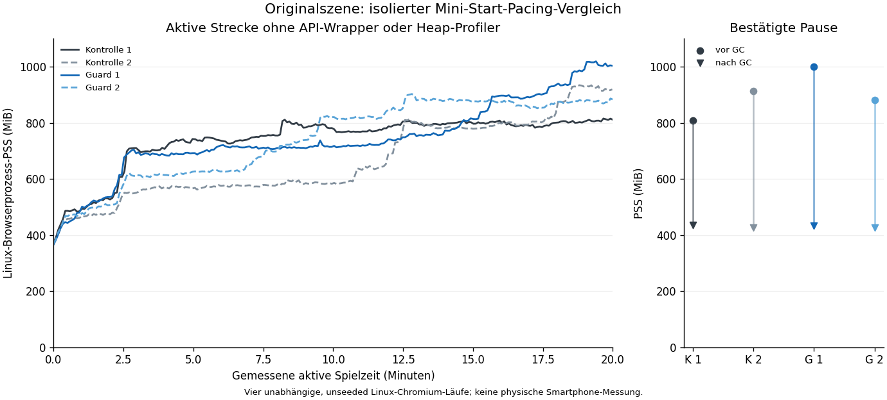

# Isolierter Mini-Start-Pacing-Vergleich – 1. November 2026

Fortsetzung von `a193945e`: Die vorherige Originalmessung zeigte 464,0 → 908,8 MiB
Median-PSS und nach inaktiver GC einen Rückgang von 911,5 auf 427,9 MiB. Der
bereinigte JS-/DOM-Bestand blieb nahe am Kurzlauf. Das ist eine konkrete Spur,
kein bewiesener mobiler Absturzgrund. Die vorherigen Belege bleiben unverändert.

Hier wird ausschließlich das bereits vorhandene Paar reversibler Guards aus
`../boss2-mini-start-control-20261101/miniStartControl.mjs` verglichen, erstmals
bei ansonsten **vollständiger Originalszene**. Die früheren Flat-, Filter-,
Canvas-, Masken-, Hotspot- und Completion-Kontrollen bleiben ausgeschaltet.

`control` lässt das komplette ursprüngliche CSS-Pacing-Modul bytegleich.
`bypass` überspringt für Boss-Mini-Treffer und ihre Spark-Nachkommen die optionale
Start-Discovery/Registrierung samt Timing-Schreibzugriffen, Listenern und zusätzlicher
60-Hz-Fortschrittsquantisierung. Diese Aspekte ändern sich gemeinsam; das ist
kein reiner Vergleich eines einzelnen nativen API-Aufrufs. Die ursprünglichen
CSS-Animationen, Markup, Abschlussprüfung und übriges Pacing bleiben erhalten.
Spieluhr, Simulation, Input, Ton, Speicher-/Kaufregeln und Fortschritt werden
nicht verändert. Alle Game-Dateien bleiben gepinnt, Auslieferung deaktiviert.

## Gates vor längeren Messungen

1. Vier neue Regressionen prüfen exakte Reversibilität, verbotene Fremdflags,
   notwendige positive/negative Nachweise und die tatsächlich installierten
   QA-Wrapper einschließlich korrektem Entfernen von Listenern. Bestehende
   Pacing-/Inspektions-/Auswertungsprüfungen bleiben erhalten (zusammen 15 Fälle).
2. Beide virtuellen vollständigen TypeScript-Varianten müssen bestehen.
3. Zwei frische 60-Sekunden-Chromium-Läufe prüfen die echten Mini-Start-Abfragen
   und Timing-Schreibzugriffe: im Original positiv, mit Guard null; sichtbare
   native Start-/End-Ereignisse und andere Timing-Pfade müssen positiv bleiben.
   Nur diese Kurzläufe installieren native API-Zähler. Sie verändern keine
   Aufrufargumente/-ergebnisse, setzen keine Uhren und fragen keine zusätzlichen
   Animationslisten ab. Ihre Heap-/PSS-Werte sind kein unveränderter Kontrollwert
   für die nachfolgenden Läufe ohne diese Wrapper.
4. Erst wenn beide Kurzläufe bestehen, beginnen vier unabhängige 20-Minuten-
   Messungen: zwei Wiederholungen pro Bedingung auf frischen Browserprozessen.
   Diese verwenden den vorhandenen Lebensdauer-Profiler ohne aktive API-Wrapper,
   Heap-Profiler, GC, Snapshot oder nativen Animationsscan. Die vorhandenen
   skalaren Besitzerzähler werden weiter abgelesen. Schwere Aufnahmen folgen
   ausschließlich nach bestätigter Pause beziehungsweise regulärem Home-Ausstieg.

Die Szenen sind unseeded. Quellen, Engine, tatsächlich installierte Bibliotheken,
gemessene aktive Zeit, Volleys und alle Freigabegrenzen müssen gemeinsam geprüft
werden. Zwei Wiederholungen liefern noch keine Smartphone-Freigabe oder belastbare
allgemeine Effektgröße. Ein grüner Erfassungslauf bedeutet keinen reparierten
White Screen. Die offene WebKit-Original-Startlücke bleibt ein gesonderter Befund.

## Bestätigte Kurzkontrollen

Gemessene Quelle `668d4115716bdb425947c4847e70113e8c497990`, Baum
`cb0bed431f842cad4067e23ebb3e2036c243b04c`,
[CI 41343318455](https://github.com/19Trojan69/cryptoid-evolution/actions/runs/41343318455).
Die Quellen-Gates, beide kurzen nativen Kontrollen und alle vier 20-Minuten-
Messungen sind erfolgreich abgeschlossen. Eine Speicherverbesserung durch die
Guards wurde dabei **nicht nachgewiesen**; sie werden aus diesen Daten nicht als
Speicherkorrektur übernommen.

| tatsächlich gezählter nativer Pfad | Original | Guard |
| --- | ---: | ---: |
| gemessene aktive Stoppuhrzeit | 60.000,1 ms | 61.000,0 ms |
| Mini-Start-Ereignisse | 1.022 | 1.022 |
| Mini-Zielabfragen während Start-Discovery | 1.022 | 0 |
| Timing-Schreibzugriffe bei aktuell zugeordnetem Mini-Ziel | 1.230 | 0 |
| verbleibende Mini-Abfragen außerhalb der Start-Discovery | 208 | 210 |
| native Mini-End-Ereignisse | 208 | 210 |

Damit ist der vorgesehene Startpfad im Original beobachtet und beim Guard
ausgeschlossen; die ursprüngliche Abschlussabfrage wird weiterhin tatsächlich
beobachtet. Der Zähler `otherTimingUpdates` bleibt in beiden Fällen positiv.
Er klassifiziert das Ziel beim Aufruf. Bei bereits entfernten Elementen kann die
frühere Mini-Zuordnung fehlen; er ist deshalb kein sauberer Mengenvergleich aller
anderen Animationen und kein Beweis identischer Arbeit außerhalb der Minis.
Die Quellenprüfung und die vorhandenen Nicht-Mini-Regressionen sichern den engen
Codeeingriff. Ungleiche End-Ereigniszahlen werden nicht in gleiche Renderarbeit
umgedeutet.

Beide Kurzläufe erreichen Pause, regulären Home-Ausstieg und leeres neues
Dokument. Die komprimierten Original-JSON bleiben verlustfrei gesichert. Beide
ZIP-Digests/Integritäten und alle vier Kurzlauf-Snapshots wurden geprüft und ihre
Größen-/Klassensummen erneut aus den Originalgraphen berechnet. Fünf weitere
Offline-Regressionen verhindern Quellen-/Bedingungsmischung, fehlende positive
Signale, als Langlauf umetikettierte Kurzdaten, API-Zähler im Langlauf und
unvollständige beziehungsweise doppelte Wiederholungen.

Der normale Buildpfad ohne neues Flag wurde zusätzlich gebaut: weder neuer
Vergleich noch Inspektionsbrücke sind darin enthalten. Die 14 bestehenden
Preview-/Heap-Prüfungen bestehen ebenso wie die 15 Quellen-/Inspektionsfälle
und die fünf neuen Offline-Annahmefälle (34 Fälle lokal, davon 15 auch in der CI).
Spielquellen-Pins sind unverändert. Es gibt hier keine neue Geräte-URL und keinen
als Verbesserung akzeptierten Spiel-Patch.

## Abgeschlossene wiederholte Langmessung

Jeder der vier Läufe erfasst mindestens 1.200.000 ms aktive Stoppuhrzeit und
428 zusätzliche Boss-Kernsalven, ohne aktiven Heap-Profiler, native API-Wrapper,
Snapshot, Animationsscan oder erzwungene GC. Alle verwenden Chromium
151.0.7922.34 mit denselben tatsächlich gelesenen React-/Router-/Vite-/TypeScript-
Versionen und demselben Lock-Digest. Die Daten bleiben unseeded und stammen von
getrennten Linux-Runnern; gleiche Salvenzahlen beweisen keine identische Renderarbeit.

| Bedingung | Median-PSS letzte aktive Minute | PSS Pause nach GC | aktive Stichprobe: kumulierte Pacing-Konfigurationen |
| --- | ---: | ---: | ---: |
| Original 1 | 809,3 MiB | 435,0 MiB | 23.310 |
| Original 2 | 923,0 MiB | 427,5 MiB | 23.304 |
| Guard 1 | 1.009,3 MiB | 434,0 MiB | 2.773 |
| Guard 2 | 877,4 MiB | 426,6 MiB | 2.768 |



**Nachgewiesen:** Die optionale Pacing-Registrierung sinkt in diesem Aufbau um
rund 88 Prozent. Die starke aktive Speicherzunahme bleibt in beiden Guard-Läufen
vorhanden, die Bereiche der Bedingungen überlappen. Die Verläufe zeigen auch
größere Sprünge und unterschiedliche Bereinigungszeitpunkte. Ein einzelner
Endwert oder ein gelungenes 20-Minuten-Spiel ist kein stabiler Freigabebeweis.

Nach GC liegen die belegten JS-Heaps aller vier pausierten Szenen zwischen
10.641.240 und 10.673.568 Byte. Nach Home sind CSS-Registrierungen, Bild-Pins,
Effektcache und Spiel-Canvas freigegeben; CDP zählt jeweils 247 DOM-Knoten und 210
JS-Listener. Die Native-Snapshots zeigen jeweils null CSSAnimation-, KeyframeEffect-
und AudioBuffer-Instanzen nach Home. Die sieben verbliebenen192px-Canvas passen
weiterhin zum begrenzten Steintexturcache. In allen vier aktiven Strecken bleiben
die gelesenen CSS-Fallbacks, Canvas-Fehler und Audio-Uhrstillstände bei null.

**Nicht nachgewiesen:** eine reproduzierbare Speicherverbesserung durch diesen
Guard, eine kausale Verschlechterung, ein bestimmter nativer Absturzgrund oder
eine Smartphone-Behebung. Zwei unseeded Wiederholungen je Bedingung ergeben keine
allgemeine Effektgröße. Die viel niedrigeren alten Mini-Start-Werte aus dem
reduzierten Szenenaufbau dürfen weiterhin nicht diesem Guard zugeschrieben werden.

**Entscheidung zur Behebung:** Den Guard nicht als nachgewiesene Speicherkorrektur
ins Spiel übernehmen. Die vorhandenen Spielfunktionen und der vollständige
Originalstand bleiben erhalten. Der nächste gezielte Schritt ist die native
Allokatorzuordnung im Renderer nach derselben längeren aktiven Strecke, mit
Aufnahmen ausschließlich in der bestätigten Pause vor/nach GC und nach dem
Ausstieg. Die vorhandenen 90-Sekunden-Traces und deren bereits korrigierter Parser
werden dafür wiederverwendet, einschließlich genauer unsigned-Hex-Werte und
strenger chronologischer Zuordnung der expliziten Dump-Anforderungen.

Alle sechs ZIP-Digests/Integritäten und zwölf Heap-Snapshots wurden geprüft.
Die sechs synthetischen Ergebnis-JSON bleiben verlustfrei komprimiert, die
ausgewählten Snapshot-Klassen-/Größensummen reproduziert und alle Zusammenfassungen
digestgeprüft. Sieben Offline-Annahmefälle bestehen; ein zusätzlicher negativer
Fall zeigte zunächst, dass fehlende Bibliotheks-/Engine-Angaben in allen Dateien
irrtümlich als gleich gelten konnten. Der Verifier verlangt diese Angaben jetzt
ausdrücklich und lehnt unvollständige oder gemischte Kohorten ab. Das war ein
Auswertungsfehler, kein Spielfehler; die Originalaufnahmen enthalten sämtliche
Angaben und wurden nach der Korrektur erneut akzeptiert. Insgesamt bestehen 36
gezielte lokale Prüfungen; 15 davon auch im unveränderten Quellen-Gate der CI.
Ein physischer Geräte-Langtest ist für diese weitere technische Zuordnung noch
nicht erforderlich.

```bash
node --test verification/isolated-mini-pacing-20261101/comparison.test.mjs
node verification/isolated-mini-pacing-20261101/preflight.mjs
node --test verification/isolated-mini-pacing-20261101/evidence/summary.test.mjs
node verification/isolated-mini-pacing-20261101/evidence/verifyEvidence.mjs
VERCEL_ENV=preview CRYPTOID_SOAK_CONDITION=original CRYPTOID_LIFETIME_ATTRIBUTION=1 CRYPTOID_ISOLATED_MINI_PACING=bypass node verification/systematic-stability-20261101/prepareSoakBuild.mjs
CRYPTOID_SOAK_CONDITION=original CRYPTOID_LIFETIME_ATTRIBUTION=1 CRYPTOID_ISOLATED_MINI_PACING=bypass CRYPTOID_ISOLATED_PATH_PROOF=1 CRYPTOID_ATTRIBUTION_SECONDS=60 node verification/memory-retention-attribution-20261101/profileLifetime.mjs
```
